# DART: Decentralized Acoustic Reconnaissance & Triangulation

DART is a privacy-first, peer-to-peer gunshot detection and acoustic localization platform. By combining low-cost **Edge TinyML sensors**, a **Decentralized Hash Table (Holochain DHT)**, and **deterministic physical validation rules**, DART delivers real-time shooter coordinates without centralized servers, cloud subscriptions, or privacy-invasive continuous audio eavesdropping.

---

## Table of Contents
1. [Implemented Architecture & Pipeline](#implemented-architecture--pipeline)
   - [Implemented Flowchart & Component Mapping](#implemented-flowchart--component-mapping)
   - [Component & File Execution Sequence](#component--file-execution-sequence)
2. [Proposed Architecture](#proposed-architecture)
   - [High-Level Executive Overview](#1-high-level-executive-overview-5-step-flow)
   - [Detailed Technical Blueprint](#2-detailed-technical-blueprint-deep-dive)
   - [Tier 1: Edge Sensing Nodes (Streetlamp Units)](#tier-1-edge-sensing-nodes-streetlamp-units)
   - [Tier 2: Local Fog Gateways (Cluster Hubs)](#tier-2-local-fog-gateways-cluster-hubs)
   - [Tier 3: Decentralized Ledger & Validation Mesh (Holochain DHT)](#tier-3-decentralized-ledger--validation-mesh-holochain-dht)
   - [Tier 4: Municipal CAD & First Responder Dispatch](#tier-4-municipal-cad--first-responder-dispatch)
   - [End-to-End Incident Lifecycle](#end-to-end-incident-lifecycle)
3. [Acoustic AI & TinyML Pipeline](#acoustic-ai--tinyml-pipeline)
4. [Mathematical & Physical Formulations](#mathematical--physical-formulations)
5. [Holochain Deterministic Validation](#holochain-deterministic-validation)
6. [Repository Structure](#repository-structure)
7. [Getting Started & Installation](#getting-started--installation)

---

## Implemented Architecture & Pipeline

> [!IMPORTANT]
> **Implemented System Documentation & Visuals:**
> - **Full Implemented Architecture Document**: [IMPLEMENTED_ARCHITECTURE.md](file:///c:/Users/Pratyasha/Documents/Holochain/documents/IMPLEMENTED_ARCHITECTURE.md)
> - **Interactive Flowchart Viewer**: [implemented_architecture_diagram.html](file:///c:/Users/Pratyasha/Documents/Holochain/documents/implemented_architecture_diagram.html)
> - **Vector SVG / Image**: [implemented_architecture_diagram.svg](file:///c:/Users/Pratyasha/Documents/Holochain/documents/implemented_architecture_diagram.svg)

### Implemented Flowchart & Component Mapping

The system currently implemented in this repository operates across **four sequential stages**:
1. **Stage 1 (Feature Extraction)**: `verify_dataset.py` & `extract_features.py` transform raw audio waveforms into balanced $128 \times 126$ Log-Mel spectrogram arrays (`X_features.npy`, `y_labels.npy`, `fold_assignments.npy`).
2. **Stage 2 (Model Training & Quantization)**: `train_model.py` performs SpecAugment data augmentation, evaluates 10-fold cross-validation, and exports the normalized INT8 quantized model (`gunshot_detector.tflite`, `mean.npy`, `std.npy`).
3. **Stage 3 (Real-Time Edge Listener)**: `app/gunshot_listener.py` samples continuous audio at $16\text{ kHz}$ in a 4.0s volatile RAM ring buffer, triggers on RMS energy $> 0.015$, runs on-device INT8 inference, and confirms gunshots when confidence $\ge 0.75$.
4. **Stage 4 (Decentralized Consensus)**: `acoustic_app` (Integrity & Coordinator Zomes) enforces deterministic WebAssembly speed-of-sound limits ($343\text{ m/s}$) to mathematically drop spoofed alerts and commits validated claims to the Holochain DHT.

---

## Proposed Architecture

The proposed architecture adopts a four-tier **Edge-to-Fog-to-DHT** hierarchy designed for city-scale municipal deployments. It guarantees sub-second alert generation, eliminates single points of failure, preserves citizen privacy, and mathematically prevents spoofed sensor inputs.

> [!TIP]
> **Downloadable Architecture Diagrams (White Background):**
> - **Simplified 5-Step Overview**: [simple_architecture_diagram.png (High-Res)](file:///c:/Users/Pratyasha/Documents/Holochain/documents/simple_architecture_diagram.png) | [Vector SVG](file:///c:/Users/Pratyasha/Documents/Holochain/documents/simple_architecture_diagram.svg) | [Interactive HTML Viewer](file:///c:/Users/Pratyasha/Documents/Holochain/documents/simple_architecture_diagram.html)
> - **Detailed Technical Blueprint**: [proposed_architecture_diagram.png (1.2 MB)](file:///c:/Users/Pratyasha/Documents/Holochain/documents/proposed_architecture_diagram.png) | [Vector SVG](file:///c:/Users/Pratyasha/Documents/Holochain/documents/proposed_architecture_diagram.svg) | [Interactive HTML Viewer](file:///c:/Users/Pratyasha/Documents/Holochain/documents/proposed_architecture_diagram.html)
> - **Full System Architecture Spec**: [PROPOSED_ARCHITECTURE.md](file:///c:/Users/Pratyasha/Documents/Holochain/documents/PROPOSED_ARCHITECTURE.md)

### 1. High-Level Executive Overview (5-Step Flow)

```mermaid
%%{init: {
  'theme': 'base',
  'themeVariables': {
    'darkMode': false,
    'background': '#ffffff',
    'mainBkg': '#ffffff',
    'lineColor': '#37474f',
    'textColor': '#263238',
    'fontSize': '14px',
    'fontFamily': '-apple-system, BlinkMacSystemFont, "Segoe UI", Roboto, Arial, sans-serif'
  },
  'flowchart': {
    'htmlLabels': true,
    'curve': 'basis',
    'nodeSpacing': 35,
    'rankSpacing': 40,
    'padding': 25
  }
}}%%
flowchart LR
    classDef eventStep fill:#ffebee,stroke:#e53935,stroke-width:2px,color:#b71c1c;
    classDef edgeStep fill:#e1f5fe,stroke:#0288d1,stroke-width:2px,color:#01579b;
    classDef fogStep fill:#e8f5e9,stroke:#43a047,stroke-width:2px,color:#1b5e20;
    classDef dhtStep fill:#fff3e0,stroke:#fb8c00,stroke-width:2px,color:#e65100;
    classDef cadStep fill:#f3e5f5,stroke:#8e24aa,stroke-width:2px,color:#4a148c;

    EVENT["&nbsp;<br/>💥 <b>1. Gunshot Fired</b><br/><b>Acoustic Wave Expands</b><br/>Supersonic shockwave & blast<br/>travel at 343 m/s<br/>&nbsp;"]:::eventStep

    EDGE["&nbsp;<br/>🎙️ <b>2. Streetlamp Sensors</b><br/><b>Privacy-Safe TinyML</b><br/>• Temporary 4s memory (RAM only)<br/>• 44 KB AI detects gunshot in 40ms<br/>&nbsp;"]:::edgeStep

    FOG["&nbsp;<br/>📦 <b>3. Utility Box Hub</b><br/><b>Cluster Triangulation</b><br/>• Collects 3+ sensor timestamps<br/>• Solves hyperbolic TDoA for (X, Y)<br/>&nbsp;"]:::fogStep

    DHT["&nbsp;<br/>🔗 <b>4. Holochain P2P Mesh</b><br/><b>Physics-Based Consensus</b><br/>• Enforces speed-of-sound limits<br/>• Rejects spoofed or fake alerts<br/>&nbsp;"]:::dhtStep

    CAD["&nbsp;<br/>🚓 <b>5. 911 CAD Dispatch</b><br/><b>Tactical Response</b><br/>• Pinpoints shooter on police map<br/>• Alert delivered in under 1 second<br/>&nbsp;"]:::cadStep

    EVENT -->|"Sound waves"| EDGE
    EDGE -->|"Wireless telemetry"| FOG
    FOG -->|"P2P gossip"| DHT
    DHT -->|"Real-time WebSocket"| CAD
```



---

### 2. Detailed Technical Blueprint (Deep Dive)

```mermaid
%%{init: {
  'theme': 'base',
  'themeVariables': {
    'darkMode': false,
    'background': '#ffffff',
    'mainBkg': '#ffffff',
    'lineColor': '#263238',
    'textColor': '#1a237e',
    'fontSize': '13px',
    'fontFamily': '-apple-system, BlinkMacSystemFont, "Segoe UI", Roboto, Arial, sans-serif'
  },
  'flowchart': {
    'htmlLabels': true,
    'curve': 'basis',
    'nodeSpacing': 50,
    'rankSpacing': 60,
    'padding': 30
  }
}}%%
flowchart TD
    %% Global Styling
    classDef physicalEvent fill:#ffebee,stroke:#c62828,stroke-width:2px,color:#b71c1c;
    classDef edgeTier fill:#e1f5fe,stroke:#0277bd,stroke-width:2px,color:#01579b;
    classDef fogTier fill:#e8f5e9,stroke:#2e7d32,stroke-width:2px,color:#1b5e20;
    classDef dhtTier fill:#fff3e0,stroke:#ef6c00,stroke-width:2px,color:#e65100;
    classDef cadTier fill:#f3e5f5,stroke:#7b1fa2,stroke-width:2px,color:#4a148c;
    classDef subNode fill:#ffffff,stroke:#0288d1,stroke-width:1.5px,color:#01579b;

    %% Acoustic Source
    GUNSHOT["&nbsp;<br/><b>Acoustic Discharge Event</b><br/>Supersonic Shockwave & Muzzle Blast (343 m/s)<br/>&nbsp;"]:::physicalEvent

    %% Tier 1: Edge Nodes
    subgraph TIER1["Tier 1: Streetlamp Edge Nodes (Volatile RAM & TinyML)"]
        subgraph NODE_A["Streetlamp Node A (Arduino Nano 33 BLE)"]
            MIC_A["&nbsp;<br/><b>PDM Mic</b><br/>(16 kHz Sampling)<br/>&nbsp;"]:::subNode --> BUF_A["&nbsp;<br/><b>Volatile 4.0s Ring Buffer</b><br/>(64k samples in RAM)<br/>&nbsp;"]:::subNode
            BUF_A --> RMS_A{"&nbsp;<br/>RMS > 0.015?<br/>&nbsp;"}:::subNode
            RMS_A -- "Yes (Spike)" --> MEL_A["&nbsp;<br/><b>STFT & Log-Mel</b><br/>(128x126 matrix)<br/>&nbsp;"]:::subNode
            MEL_A --> CNN_A["&nbsp;&nbsp;<b>TinyML INT8 CNN</b>&nbsp;&nbsp;<br/>&nbsp;&nbsp;(44 KB Quantized Model)&nbsp;&nbsp;"]:::subNode
            CNN_A --> CONF_A{"&nbsp;<br/>Score &ge; 0.75?<br/>&nbsp;"}:::subNode
            CONF_A -- "Confirmed" --> PKT_A["&nbsp;<br/><b>Signed Observation Packet A</b><br/>(Timestamp, Geo, Signature)<br/>&nbsp;"]:::subNode
        end

        subgraph NODE_B["Streetlamp Node B (Arduino Nano 33 BLE)"]
            MIC_B["&nbsp;<br/><b>PDM Mic</b><br/>(16 kHz Sampling)<br/>&nbsp;"]:::subNode --> BUF_B["&nbsp;<br/><b>Volatile 4.0s Ring Buffer</b><br/>(64k samples in RAM)<br/>&nbsp;"]:::subNode
            BUF_B --> RMS_B{"&nbsp;<br/>RMS > 0.015?<br/>&nbsp;"}:::subNode
            RMS_B -- "Yes" --> CNN_B["&nbsp;&nbsp;<b>TinyML INT8 CNN</b>&nbsp;&nbsp;<br/>&nbsp;&nbsp;(44 KB Quantized Model)&nbsp;&nbsp;"]:::subNode
            CNN_B --> PKT_B["&nbsp;<br/><b>Signed Observation Packet B</b><br/>(Timestamp, Geo, Signature)<br/>&nbsp;"]:::subNode
        end

        subgraph NODE_C["Streetlamp Node C (ESP32-S3)"]
            MIC_C["&nbsp;<br/><b>PDM Mic</b><br/>(16 kHz Sampling)<br/>&nbsp;"]:::subNode --> BUF_C["&nbsp;<br/><b>Volatile 4.0s Ring Buffer</b><br/>(64k samples in RAM)<br/>&nbsp;"]:::subNode
            BUF_C --> RMS_C{"&nbsp;<br/>RMS > 0.015?<br/>&nbsp;"}:::subNode
            RMS_C -- "Yes" --> CNN_C["&nbsp;&nbsp;<b>TinyML INT8 CNN</b>&nbsp;&nbsp;<br/>&nbsp;&nbsp;(44 KB Quantized Model)&nbsp;&nbsp;"]:::subNode
            CNN_C --> PKT_C["&nbsp;<br/><b>Signed Observation Packet C</b><br/>(Timestamp, Geo, Signature)<br/>&nbsp;"]:::subNode
        end
    end

    GUNSHOT -. "Sound Wavefront (Speed: 343 m/s)" .-> MIC_A
    GUNSHOT -. "Sound Wavefront (Speed: 343 m/s)" .-> MIC_B
    GUNSHOT -. "Sound Wavefront (Speed: 343 m/s)" .-> MIC_C

    %% Tier 2: Fog Gateway
    subgraph TIER2["Tier 2: Municipal Fog Gateway (Utility Box - Raspberry Pi 4 / CM4)"]
        RX["&nbsp;<br/><b>Encrypted Wireless Ingestion</b><br/>(BLE 5.0 Long Range / LoRaWAN)<br/>&nbsp;"]:::fogTier
        COINC{"&nbsp;<br/><b>Coincidence Check</b><br/>&Delta;t &lt; 1.5s across 3+ nodes<br/>&nbsp;"}:::fogTier
        BUNDLE["&nbsp;<br/><b>Cluster Claim Bundler</b><br/>(Requires &ge; 3 Distinct Sensors)<br/>&nbsp;"]:::fogTier
        TDOA_SOLVE["&nbsp;<br/><b>Hyperbolic TDoA Multilateration</b><br/>Initial (X, Y) Coordinate Solver<br/>&nbsp;"]:::fogTier
        CONDUCTOR["&nbsp;<br/><b>Local Holochain Conductor</b><br/>(Peer Validator Node)<br/>&nbsp;"]:::fogTier

        RX --> COINC
        COINC -- "Count >= 3" --> BUNDLE
        BUNDLE --> TDOA_SOLVE
        TDOA_SOLVE --> CONDUCTOR
    end

    PKT_A --> RX
    PKT_B --> RX
    PKT_C --> RX

    %% Tier 3: Holochain DHT
    subgraph TIER3["Tier 3: Holochain Decentralized P2P Ledger & Validation Mesh"]
        GOSSIP["&nbsp;<br/><b>Peer-to-Peer Network Gossip</b><br/>(WebRTC / Kitsune2 Protocol)<br/>&nbsp;"]:::dhtTier
        VALIDATOR{"&nbsp;<br/><b>Deterministic WASM Validator</b><br/>(Physical Rule Engine HDI 0.6.x)<br/>&nbsp;"}:::dhtTier
        CHECK_STRUCT["&nbsp;<br/>1. Structure: len(observations) &ge; 3<br/>&nbsp;"]:::dhtTier
        CHECK_FINITE["&nbsp;<br/>2. Geometry: Coordinates Finite (!NaN && !Inf)<br/>&nbsp;"]:::dhtTier
        CHECK_PHYSICS["&nbsp;<br/>3. Causality: |t_i - t_j| &le; (d_ij / 343.0) + 50ms<br/>&nbsp;"]:::dhtTier
        DHT_COMMIT[("&nbsp;<br/><b>Immutable Distributed Hash Table (DHT)</b><br/>Anchor Index: 'all_claims'<br/>&nbsp;")]:::dhtTier

        CONDUCTOR --> GOSSIP
        GOSSIP --> VALIDATOR
        VALIDATOR --> CHECK_STRUCT --> CHECK_FINITE --> CHECK_PHYSICS
        CHECK_PHYSICS -- "Physically Validated" --> DHT_COMMIT
        CHECK_PHYSICS -- "Speed of Sound Violated" --> REJECT["&nbsp;<br/><b>Reject Claim</b><br/>Drop Spoofed or Non-Physical Entry<br/>&nbsp;"]:::physicalEvent
    end

    %% Tier 4: Municipal Dispatch
    subgraph TIER4["Tier 4: Municipal CAD & Tactical Responder UI"]
        WS_EVENT["&nbsp;<br/><b>Secure WebSocket Dispatch</b><br/>(Real-Time JSON Stream)<br/>&nbsp;"]:::cadTier
        TAPI["&nbsp;<br/><b>TAPI Threat Prioritization</b><br/>Automatic Fire Analysis & Caliber Est.<br/>&nbsp;"]:::cadTier
        CAD_MAP["&nbsp;<br/><b>911 CAD Interactive Map</b><br/>Pinpoints Shooter & Perimeter Circle<br/>&nbsp;"]:::cadTier
        MDT["&nbsp;<br/><b>Patrol Vehicle Mobile Terminal</b><br/>Turn-by-turn Navigation to (X, Y)<br/>&nbsp;"]:::cadTier

        DHT_COMMIT --> WS_EVENT
        WS_EVENT --> TAPI
        TAPI --> CAD_MAP
        CAD_MAP --> MDT
    end
```



### Tier 1: Edge Sensing Nodes (Streetlamp Units)
* **Mounting & Power**: Installed directly atop streetlamps, tapping continuous $12\text{V}/24\text{V}$ municipal lighting power with a miniature rechargeable supercapacitor/battery backup.
* **Microcontroller Target**: Low-power microcontrollers such as the **Arduino Nano 33 BLE Sense** (Nordic nRF52840 ARM Cortex-M4F @ 64 MHz, 256 KB RAM) or **ESP32-S3**.
* **Microphone**: Omnidirectional digital PDM (Pulse Density Modulation) microphone (e.g., MP34DT05) sampling at **16,000 Hz**.
* **Zero-Recording Privacy Guarantee**:
  * Audio samples are held strictly in a volatile 4.0-second circular ring buffer (`deque` of 64,000 floats).
  * Audio is **never recorded to flash memory, SD card, or persistent storage**.
  * Audio older than 4.0 seconds is immediately overwritten and permanently destroyed.
* **Acoustic Wake-up Trigger**:
  * An ultra-fast Root Mean Square (RMS) loudness detector monitors incoming frames.
  * The edge processor stays in a low-power listening state ($< 15\text{ mA}$).
  * Only when an acoustic shock exceeds the calibrated volume trigger threshold (`VOLUME_TRIGGER_THRESHOLD = 0.015`) does the chip freeze the RAM snapshot and invoke the TinyML model.
* **On-Device Inference**:
  * Generates a $128 \times 126$ Log-Mel Spectrogram.
  * Runs the **44 KB INT8 Quantized CNN** (`gunshot_detector.tflite`).
  * If confidence $\ge 0.75$, creates a localized reading packet:
    $$\text{Observation} = \{ \text{node\_id}, X, Y, t_{\text{arrival}}, \text{confidence} \}$$
  * Dispatches this telemetry packet over low-latency wireless to Tier 2.

### Tier 2: Local Fog Gateways (Cluster Hubs)
* **Mounting**: Weatherproof NEMA enclosures mounted inside existing municipal traffic control boxes or utility cabinets.
* **Hardware**: **Raspberry Pi 4 / Compute Module 4 (CM4)** with 4GB RAM running Linux, or industrial edge Linux boxes.
* **Sector Coverage**: Each Fog Gateway manages a regional cluster of 5 to 10 Tier 1 streetlamp nodes within a $200\text{ m} - 500\text{ m}$ radius.
* **Wireless Ingestion**: Receives incoming observation packets via BLE 5.0 Long Range (Coded PHY), LoRa, or IEEE 802.15.4.
* **Temporal Coincidence Aggregator**:
  * When Node A reports a gunshot at time $t_A$, the gateway opens an aggregation window of $1.5\text{ seconds}$ (the maximum travel time of sound across a $500\text{ m}$ street cluster).
  * Collects matching detections from Node B and Node C.
  * Once $\ge 3$ distinct nodes register the event, the gateway bundles them into an `AcousticTriangulationClaim`.
* **Hyperbolic TDoA Engine**: Solves the non-linear hyperbolic time-difference equations to produce the preliminary shooter coordinate $(X_s, Y_s)$.
* **Holochain Node**: Hosts a Holochain conductor instance connected to the municipal P2P network.

### Tier 3: Decentralized Ledger & Validation Mesh (Holochain DHT)
* **P2P Topology**: Every Fog Gateway and central police dispatch server operates as a peer node on the Holochain network. There is **no central cloud database**.
* **Anti-Spoofing Deterministic Validation (WASM)**:
  * When a gateway proposes an `AcousticTriangulationClaim`, neighboring validator nodes on the DHT execute the deterministic WASM integrity rules:
    1. **Structure Check**: The claim must contain $\ge 3$ unique sensor observations.
    2. **Finite Coordinate Check**: Rejects any non-finite numbers (`NaN`, `Inf`) to prevent mathematical comparison bypasses.
    3. **Physical Causality Check**: For every sensor pair $(i, j)$ separated by distance $d_{ij}$:
       $$|t_i - t_j| \le \frac{d_{ij}}{343.0\text{ m/s}} + 0.050\text{ s}$$
       If the recorded time difference violates the physical speed of sound, the entry is **instantly rejected** as physical spoofing or an unrelated noise spike.
* **Tamper-Proof Audit Trail**: Validated claims are committed to immutable agent source chains and indexed to the `all_claims` DHT anchor, establishing an unalterable evidentiary record for criminal investigations.

### Tier 4: Municipal CAD & First Responder Dispatch
* **Computer-Aided Dispatch (CAD) Integration**: Receives real-time push events from the local Holochain conductor over WebSockets.
* **Threat Assessment & Priority Index (TAPI)**:
  * Computes an incident urgency score based on AI confidence, number of confirming sensors, and multiple rapid discharges (automatic gunfire detection).
* **Tactical Responder UI**:
  * Displays precise GPS coordinates on GIS maps (OpenStreetMap/Google Maps).
  * Shows estimated error ellipses, acoustic sensor arrival rays, and nearest street intersections for emergency vehicle routing.

---

### End-to-End Incident Lifecycle

| Step | Time Offset | Physical Location | Action / Execution |
| :---: | :---: | :--- | :--- |
| **0** | $T = 0.00\text{ s}$ | Street / Alley | Firearm discharge occurs. Supersonic bullet crack and muzzle blast expand at $343\text{ m/s}$. |
| **1** | $T + 0.05\text{ s}$ | Streetlamp Node A ($17\text{ m}$) | PDM mic detects acoustic energy spike; RMS threshold wakes up TinyML engine from volatile RAM. |
| **2** | $T + 0.20\text{ s}$ | Streetlamp Node B ($68\text{ m}$) | Node B detects spike; freezes RAM buffer; extracts Mel spectrogram. |
| **3** | $T + 0.35\text{ s}$ | Streetlamp Node C ($120\text{ m}$) | Node C detects spike; completes on-device INT8 CNN inference; classifies as gunshot ($99.6\%$). |
| **4** | $T + 0.45\text{ s}$ | Wireless Link | Nodes A, B, and C transmit signed observation packets to the sector Fog Gateway. |
| **5** | $T + 0.60\text{ s}$ | Fog Gateway (Utility Box) | Aggregator bundles observations; validates $\ge 3$ nodes; computes initial TDoA $(X, Y)$ coordinates. |
| **6** | $T + 0.75\text{ s}$ | Holochain P2P Mesh | Gateway executes `create_triangulation_claim`; peer validators verify speed-of-sound limits; claim is committed to DHT. |
| **7** | $T + 0.95\text{ s}$ | Police Dispatch (CAD) | Real-time WebSocket event delivers verified shooter coordinates and TAPI score to first-responder navigation screens. |

---

## Acoustic AI & TinyML Pipeline

> [!TIP]
> **Machine Learning Architecture & Deep Documentation:**
> - **Exhaustive ML Technical Deep Dive**: [MACHINE_LEARNING_PIPELINE.md](file:///c:/Users/Pratyasha/Documents/Holochain/documents/MACHINE_LEARNING_PIPELINE.md)
> - **ML Pipeline High-Res PNG**: [ml_pipeline_diagram.png](file:///c:/Users/Pratyasha/Documents/Holochain/documents/ml_pipeline_diagram.png)
> - **ML Pipeline Vector SVG**: [ml_pipeline_diagram.svg](file:///c:/Users/Pratyasha/Documents/Holochain/documents/ml_pipeline_diagram.svg)
> - **Interactive ML Flowchart Viewer**: [ml_pipeline_diagram.html](file:///c:/Users/Pratyasha/Documents/Holochain/documents/ml_pipeline_diagram.html)

The on-device classification pipeline transforms raw audio into a visual spectrogram and evaluates it through a quantized neural network:

1. **Audio Sampling**: $16,000\text{ Hz}$ mono audio.
2. **Buffer Sizing**: $4.0\text{ seconds}$ rolling duration ($64,000\text{ samples}$).
3. **Short-Time Fourier Transform (STFT)**:
   - Window size: $N_{\text{fft}} = 1024$ ($64\text{ ms}$).
   - Hop length: $H = 512$ ($32\text{ ms}$, $50\%$ overlap).
4. **Log-Mel Filterbanks**: $128$ Mel frequency bands covering $0 - 8,000\text{ Hz}$.
5. **Feature Representation**: $128 \times 126 = 16,128$ normalized float values.
6. **Quantization**: INT8 full-integer representation ($44\text{ KB}$ binary footprint) executable on ARM Cortex-M4 microcontrollers.

---

## Mathematical & Physical Formulations

### 1. Root Mean Square (RMS) Loudness Trigger
$$\text{RMS} = \sqrt{\frac{1}{N} \sum_{i=1}^{N} x[i]^2}$$
Evaluated over $100\text{ ms}$ windows ($1,600\text{ samples}$). If $\text{RMS} > 0.015$, the 4.0-second buffer is preserved for inference.

### 2. Physical Speed-of-Sound Boundary
For sensors at $(x_i, y_i)$ and $(x_j, y_j)$, physical distance is:
$$d_{ij} = \sqrt{(x_i - x_j)^2 + (y_i - y_j)^2}$$
Maximum theoretical sound propagation time:
$$\Delta t_{\text{max}} = \frac{d_{ij}}{v_{\text{sound}}} + \tau_{\text{drift}}$$
Where $v_{\text{sound}} = 343.0\text{ m/s}$ and $\tau_{\text{drift}} = 0.050\text{ s}$ ($50\text{ ms}$ clock synchronization tolerance).

### 3. Hyperbolic Time-Difference-of-Arrival (TDoA) Multilateration
For an unknown source $(x_s, y_s)$ and sensors $i$ and $j$:
$$d_i - d_j = v_{\text{sound}} \cdot (t_i - t_j) = \sqrt{(x_i - x_s)^2 + (y_i - y_s)^2} - \sqrt{(x_j - x_s)^2 + (y_j - y_s)^2}$$
With $M \ge 3$ sensors, non-linear least squares resolves $(x_s, y_s)$ uniquely at the intersection of the hyperbolas.

---

## Holochain Deterministic Validation

Holochain integrity zomes guarantee tamper-proof operation by enforcing deterministic validation inside WebAssembly:

```rust
// Integrity validation in acoustic_app/dnas/.../integrity/acoustic_app/src/lib.rs
if claim.observations.len() < 3 {
    return Ok(ValidateCallbackResult::Invalid("At least 3 sensor observations required.".to_string()));
}

for i in 0..claim.observations.len() {
    for j in (i + 1)..claim.observations.len() {
        let obs_a = &claim.observations[i];
        let obs_b = &claim.observations[j];

        // Coordinate sanity check against non-finite values
        if !obs_a.x_coord.is_finite() || !obs_a.y_coord.is_finite() || !obs_a.t_arrival.is_finite()
            || !obs_b.x_coord.is_finite() || !obs_b.y_coord.is_finite() || !obs_b.t_arrival.is_finite() {
            return Ok(ValidateCallbackResult::Invalid("Non-finite coordinate detected.".to_string()));
        }

        // Causality check
        let distance = ((obs_a.x_coord - obs_b.x_coord).powi(2) + (obs_a.y_coord - obs_b.y_coord).powi(2)).sqrt();
        let max_travel_time = distance / SPEED_OF_SOUND;
        let actual_time_delta = (obs_a.t_arrival - obs_b.t_arrival).abs();

        if actual_time_delta > (max_travel_time + CLOCK_DRIFT_BUFFER) {
            return Ok(ValidateCallbackResult::Invalid("Speed of sound limits violated.".to_string()));
        }
    }
}
```

---

## Repository Structure

```
├── app/
│   ├── gunshot_listener.py       # Real-time microphone listening loop & TinyML edge inference
│   ├── gunshot_listener_test.py  # Benchmark suite evaluating the 30 unseen audio test set
│   └── generate_paper_grid.py    # Generates 300 DPI research paper spectrogram comparison grids
├── acoustic_app/                 # Complete scaffolded Holochain application
│   ├── dnas/acoustic_app/        # Coordinator and integrity zomes (Rust / HDI 0.6.5)
│   ├── workdir/acoustic_app.dna  # Pre-compiled Holochain DNA binary (990 KB)
│   └── tests/                    # Vitest / Tryorama Holochain conductor integration tests
├── custom_data/                  # Auxiliary audio datasets (isolated gunshots and negatives)
├── documents/                    # Research documentation, formulas, and architecture slides
├── research_paper_visuals/       # High-resolution generated charts and spectrogram figures
├── unseen test/                  # 30 real-world unseen test audio files (AK47, sirens, fireworks)
├── download_dataset.py           # UrbanSound8K dataset retrieval
├── extract_features.py           # 128-band Mel spectrogram feature extraction pipeline
├── train_model.py                # TinyML CNN training, SpecAugment, and INT8 TFLite export
├── verify_dataset.py             # Audio decoder sanity checker
├── gunshot_detector.tflite       # Production 44 KB INT8 quantized model
├── mean.npy / std.npy            # Normalization statistics (16,128 elements each)
└── requirements.txt              # Pinned Python dependencies
```

---

## Getting Started & Installation

### 1. Python Environment Setup
```bash
# Activate virtual environment
.\venv\Scripts\Activate.ps1

# Install dependencies
pip install -r requirements.txt
```

### 2. Running Live Edge Listener
```bash
# Starts continuous microphone listening with INT8 TinyML detection
python app/gunshot_listener.py
```

### 3. Running Benchmark on Unseen Audio
```bash
# Evaluates 30 real-world gunshot, siren, dog bark, and firework clips
python app/gunshot_listener_test.py
```
